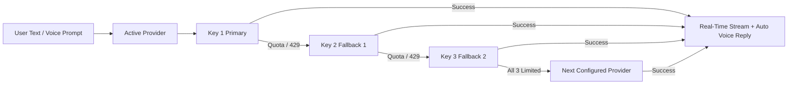

<div align="center">

<!-- Header -->
<br />

### بِسْمِ اللَّهِ الرَّحْمَٰنِ الرَّحِيمِ

# 🌙 Hidayah — Complete Muslim Lifestyle & AI Companion

**A modern, ultra-smooth Android application crafted with Jetpack Compose & Liquid Glass Material 3**  
*Offline Holy Quran • Online Quran Audio • Hidayah Multi-AI with Voice Chat • Prayer Times • Adhan • Qibla • Learn Salah • Deen Tracker*

<br />

<!-- Primary Badges -->
[](../../releases/latest)
[](https://developer.android.com)
[](https://kotlinlang.org)
[](https://developer.android.com/compose)
[](gradle/libs.versions.toml)
[](.github/workflows/build-apk.yml)

<!-- Dynamic Repo Badges -->
[](https://github.com/mansoorwanimansoorwani23-collab/Al-Quraan-deen-apk/actions/workflows/build-apk.yml)
[](https://github.com/mansoorwanimansoorwani23-collab/Al-Quraan-deen-apk/releases/latest)
[](https://github.com/mansoorwanimansoorwani23-collab/Al-Quraan-deen-apk/stargazers)

<br />

[✨ Features](#-key-features) •
[🤖 Hidayah AI](#-hidayah-ai--multi-provider-3-key-fallback--voice-chat) •
[📥 Download APK](#-download-latest-apk) •
[🏛️ Architecture](#️-architecture--project-structure) •
[🧰 Tech Stack](#-tech-stack) •
[🚀 Local Build](#-getting-started--local-build) •
[⚙️ CI/CD](#️-automated-cicd--github-releases)

</div>

---

## 🌟 Overview

**Hidayah** is an all-in-one, distraction-free Muslim lifestyle Android app designed for speed, elegance, and everyday worship—even on low-end Android devices. Built from the ground up with **Kotlin**, **Jetpack Compose**, and a custom **Liquid Glass Material 3** design system, Hidayah combines complete offline Quran reading, high-quality online Quran audio with exact resume, accurate local prayer timings, real Adhan alerts, an interactive Qibla compass, and **Hidayah AI**—a multi-provider Islamic AI assistant with voice messaging and 3-key automatic quota failover.

> **Community Dedication:** *Developed by Rauf — Especially for Pushpora Masjid and Madrasa Community.*

---

## 📥 Download Latest APK

Every push to `main` automatically builds and publishes a directly downloadable debug APK to **GitHub Releases**:

<div align="center">

[](https://github.com/mansoorwanimansoorwani23-collab/Al-Quraan-deen-apk/releases/latest)

</div>

1. Open the [**Latest Release**](https://github.com/mansoorwanimansoorwani23-collab/Al-Quraan-deen-apk/releases/latest) page on your Android phone.
2. Under **Assets**, tap the `.apk` file to download it directly (no ZIP extraction required).
3. Tap the downloaded APK and allow **"Install from unknown sources"** if prompted.

> ℹ️ *Automated release APKs are debug builds signed with a temporary debug keystore for testing and community previews.*

---

## ✨ Key Features

<table>
  <tr>
    <td width="50%" valign="top">
      <h3>📖 Complete Offline Quran & Audio</h3>
      <ul>
        <li><strong>114 Surahs Offline:</strong> Full Arabic Uthmani/Indo-Pak script with translations and customizable Quran fonts & sizes.</li>
        <li><strong>Online Quran Audio & Exact Resume:</strong> Stream renowned Qaris with background foreground-service playback, media controls, and exact position resume.</li>
        <li><strong>Recitation Practice:</strong> Dedicated practice screen to improve pronunciation and fluency.</li>
        <li><strong>Bookmarks & Fast Search:</strong> Instant Surah, Ayah, and Islamic topic search.</li>
      </ul>
    </td>
    <td width="50%" valign="top">
      <h3>🕌 Prayer Times, Adhan & Qibla</h3>
      <ul>
        <li><strong>Accurate Local Prayer Times:</strong> Offline astronomical calculations supporting multiple calculation methods & Madhhab preferences (Shafi'i / Hanafi).</li>
        <li><strong>Real Adhan Alerts:</strong> Authentic Adhan notifications & audio preview with background scheduling.</li>
        <li><strong>Live Qibla Compass:</strong> Real-time device sensor compass pointing directly toward the Kaaba.</li>
        <li><strong>GPS Auto-Detect:</strong> One-tap city & coordinates detection with manual city selection fallback.</li>
      </ul>
    </td>
  </tr>
  <tr>
    <td width="50%" valign="top">
      <h3>📿 Worship, Learning & Deen Tracker</h3>
      <ul>
        <li><strong>Learn Salah:</strong> Step-by-step illustrated prayer guide with Arabic, transliteration, and meaning.</li>
        <li><strong>Azkar, Duas & Hadith:</strong> Morning/evening Azkar, daily Duas, and authentic Hadith collections.</li>
        <li><strong>Digital Tasbeeh:</strong> Tactile Dhikr counter with smooth feedback.</li>
        <li><strong>Deen Tracker:</strong> Track daily prayers, Quran reading goals, and spiritual habits.</li>
      </ul>
    </td>
    <td width="50%" valign="top">
      <h3>💎 Liquid Glass UI & Urdu Guides</h3>
      <ul>
        <li><strong>Adaptive Material 3 Liquid Glass:</strong> Smooth performance on low-end devices with responsive insets across phones, tablets, and foldables.</li>
        <li><strong>Multiple Islamic Themes:</strong> Switch seamlessly between curated Light, Dark, and Islamic palettes.</li>
        <li><strong>Urdu Guides in "More" Drawer:</strong> Every tool in the left sidebar includes a clear Urdu title and easy-to-understand Urdu explanation of how to use it.</li>
      </ul>
    </td>
  </tr>
</table>

---

## 🤖 Hidayah AI — Multi-Provider, 3-Key Fallback & Voice Chat

Hidayah AI keeps a clean, unified **Hidayah AI** interface up front while powering reliable, quota-resilient answers behind the scenes:

| Capability | Details |
| :--- | :--- |
| **4 Supported AI Providers** | **Google Gemini** • **xAI Grok (Grok 3 / Grok 3 Mini / Grok 2)** • **OpenAI (GPT-4o / GPT-4.1)** • **Anthropic (Claude)** |
| **3 API Keys per Provider** | Save **Key 1 (Primary)**, **Key 2 (Fallback 1)**, and **Key 3 (Fallback 2)** per provider (up to **12 keys total**). |
| **Automatic Quota Failover** | If Key 1 hits a rate limit or quota error, Hidayah AI automatically rotates `Key 1 → Key 2 → Key 3` (with a 5-minute cooldown) and falls back to your next configured provider seamlessly. |
| **1-Tap Clipboard Auto-Detect** | Copy any `AIzaSy...`, `xai-...`, `sk-...`, or `sk-ant-...` key and return to Hidayah AI—an instant banner detects it and saves it to the next empty slot in one tap. |
| **Voice Messaging & Auto-Reply** | Speak directly using the composer **Mic button** in **Hindi/Hinglish**, **English**, **Urdu**, or **Arabic**. Voice messages automatically play back AI replies aloud with **Pause/Resume**, **-5s / +5s seek**, and **speed controls**. |
| **Ultra-Fast Streaming** | Real-time SSE token streaming with background audio preloading so text and voice load fast. |

### Automatic Multi-Key & Multi-Provider Failover Flow



---

## 🧰 Tech Stack

| Layer | Technology |
| :--- | :--- |
| **Language** | Kotlin `2.2.10` (Coroutines & StateFlow) |
| **UI Framework** | Jetpack Compose (BOM `2024.09.00`) + Material Design 3 |
| **Architecture** | MVVM + Unidirectional State Flow + Repository Pattern |
| **Navigation** | Jetpack Navigation Compose (`2.8.9`) |
| **Local Storage** | Room Database (`2.7.0` with KSP `2.3.5`) & DataStore Preferences (`1.1.7`) |
| **Networking** | OkHttp (`4.10.0` SSE streaming + HTTP/2 connection pooling), Retrofit (`2.12.0`), Moshi (`1.15.2`) |
| **Image Loading** | Coil Compose (`2.7.0`) |
| **Location & Sensors** | Google Play Services Location (`21.3.0`) + Android SensorManager |
| **Testing** | JUnit 4, Robolectric (`4.16.1`), Roborazzi (`1.59.0`), Coroutines Test |
| **Build & CI/CD** | Gradle `9.3.1` (Kotlin DSL), AGP `9.1.1`, Temurin Java 17, GitHub Actions |

---

## 🏛️ Architecture & Project Structure

```text
Al-Quraan-deen-apk/
├── .github/
│   └── workflows/
│       └── build-apk.yml            # Automated Debug APK build + GitHub Release publishing
├── app/
│   └── src/main/java/com/example/
│       ├── ai/                      # MultiAiProviderService, GeminiAiService, AiVoicePlayer
│       ├── audio/                   # QuranAudioPlayerManager, QuranPlaybackService, AdhanAudioPlayer
│       ├── data/                    # Room database, offline Islamic datasets, DataStore preferences
│       ├── domain/                  # Astronomical prayer time calculator & domain models
│       ├── location/                # GPS & city location helpers
│       ├── notification/            # Adhan & prayer reminder scheduling
│       ├── search/                  # Unified Islamic search engine
│       └── ui/
│           ├── components/          # Liquid Glass system, floating dock, Urdu left drawer
│           ├── screens/             # Home, Quran, Prayer, AI, Salah, Discover, Search, Tracker, Settings
│           ├── theme/               # Themes, Typography, Shapes
│           └── MainViewModel.kt     # Centralized reactive state holder
├── gradle/
│   └── libs.versions.toml           # Centralized Gradle Version Catalog (AGP 9.1.1)
├── build.gradle.kts                 # Root Gradle build configuration
├── settings.gradle.kts              # Project modules & repositories
└── metadata.json                    # App metadata
```

---

## 🚀 Getting Started & Local Build

### Prerequisites

- **JDK 17** (Temurin 17 recommended)
- **Gradle 9.3.1** (or Android Studio with Gradle 9.3.1 / AGP 9.1.1 support)
- **Android SDK** (`compileSdk 36`, `minSdk 24`)

### Setup & Build Commands

1. **Clone the repository**
   ```bash
   git clone https://github.com/mansoorwanimansoorwani23-collab/Al-Quraan-deen-apk.git
   cd Al-Quraan-deen-apk
   ```

2. **Create a temporary local debug keystore** *(only if `debug.keystore` is not already present)*
   ```bash
   keytool -genkeypair \
     -keystore ./debug.keystore \
     -storepass android \
     -alias androiddebugkey \
     -keypass android \
     -dname "CN=Android Debug,O=Android,C=US" \
     -keyalg RSA \
     -keysize 2048 \
     -validity 10000
   ```

3. **Build the Debug APK**
   ```bash
   gradle :app:assembleDebug --stacktrace --no-daemon
   ```
   Output APK path:
   ```text
   app/build/outputs/apk/debug/app-debug.apk
   ```

4. **Run Unit & Robolectric Tests**
   ```bash
   gradle :app:testDebugUnitTest
   ```

---

## ⚙️ Automated CI/CD & GitHub Releases

The repository includes a production-grade workflow at [`.github/workflows/build-apk.yml`](.github/workflows/build-apk.yml):

- **Triggers:** Automatic on every push to `main` + manual trigger via `workflow_dispatch`.
- **Environment:** `ubuntu-latest`, Temurin **Java 17** (verified), exact **Gradle 9.3.1**.
- **Security:** Uses only the built-in `${{ github.token }}` with `contents: write`. Generates an ephemeral debug keystore on the runner that is never committed, cached, or uploaded.
- **Dual Distribution:**
  1. Uploads `app/build/outputs/apk/debug/app-debug.apk` as the **`app-debug-apk`** Actions artifact (preserved even if release publishing fails).
  2. Publishes an uncompressed `<repo-name>-debug-build-<run-number>.apk` directly to **GitHub Releases** under a unique tag (`debug-apk-build-<run-number>-<run-attempt>`) marked as **Latest**.

---

## 🔒 Privacy & Security

- **User-Owned AI Keys:** API keys for Gemini, Grok, OpenAI, and Anthropic are entered by the user inside the app and stored locally in Android DataStore—never hardcoded or shared with third-party servers other than the selected AI provider.
- **Offline-First Core:** Quran reading, prayer time calculations, Azkar, Duas, Tasbeeh, and Deen Tracker work completely offline.
- **Least-Privilege Permissions:** Microphone (`RECORD_AUDIO`) and location permissions are requested at runtime only when you choose to use Voice Messaging or GPS Prayer/Qibla detection.

---

## 🤝 Contributing

Contributions, ideas, translations, and bug reports are always welcome!

1. Fork the repository
2. Create a feature branch: `git checkout -b feature/amazing-improvement`
3. Commit your changes: `git commit -m "Add amazing improvement"`
4. Push your branch: `git push origin feature/amazing-improvement`
5. Open a Pull Request or file an [Issue](../../issues)

---

<div align="center">

### 🤲 جزاك الله خيراً

**Developed with devotion by Rauf**  
*Especially for Pushpora Masjid and Madrasa Community*

If **Hidayah** helps you in your daily worship, consider giving this repository a ⭐!

</div>
